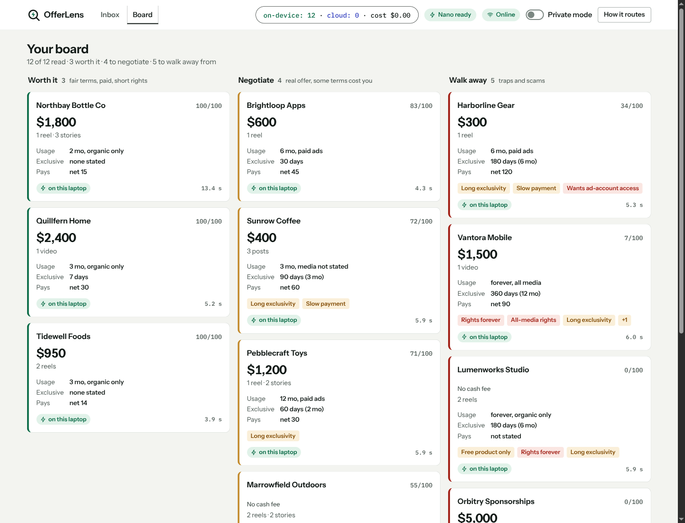

# OfferLens

**Your brand inbox, triaged by the AI on your own laptop.** Free per message, private by default. The cloud is used only when you choose to negotiate.

OfferLens is a web app for solo content creators. Paste the brand offers you get by DM and email. Gemini Nano, running inside Chrome on your own machine, pulls out the fee, usage rights, exclusivity and payment terms, flags traps and scams, and sorts every offer into **Worth it**, **Negotiate** or **Walk away**. When you want to push back, a cloud coach drafts a counter-offer from the extracted terms alone. It never sees the message.

Built for the #BuildHybridAI challenge with Firebase AI Logic hybrid inference.



## Who it is for and the problem

A creator with 10k to 500k followers gets brand offers in a stream of DMs and emails. The costly terms hide in the chat: "gifted" deals that pay nothing, usage rights that run forever or cover all media, months of exclusivity, net-90 payment, and fake "brand managers" who ask for a fee first. Reading every message carefully takes time. Pasting the messages into a cloud chatbot leaks rate cards and contacts, and a per-message cloud price grows with the inbox. Paid and gifted posts also carry a disclosure duty (FTC 16 CFR 255.5), which OfferLens reminds you about.

## How Firebase AI Logic hybrid inference is used

There are two Firebase `GenerativeModel` instances. Which call runs where is decided in one file, [`src/ai.ts`](src/ai.ts) (and [`src/coach.ts`](src/coach.ts) for the coach).

| Step | Hybrid `mode` | Runs | Why |
|---|---|---|---|
| Read each message into a `DealTerms` JSON form | `PREFER_ON_DEVICE` | On the laptop with Gemini Nano. Cloud (`gemini-3.5-flash-lite`) only when Nano is missing. | Triage runs on every message, so on-device is free per message, private, and works offline. |
| Same, with **Private mode** on | `ONLY_ON_DEVICE` | On the laptop, always. If Nano is not ready the app shows "needs on-device AI" and sends nothing. | The user controls what may leave the machine. The model instance is built on a Firebase app with no App Check, so nothing in that path can reach the network. |
| Negotiation coach | `ONLY_IN_CLOUD` (`gemini-3.5-flash-lite`, `startChat`) | Cloud | A multi-turn chat is not supported on-device. It receives only the extracted `DealTerms` JSON (and an optional minimum fee), never the message, handle or email. |
| Mask contacts, check numbers, flag scams, score and rank | plain TypeScript | On the laptop | The model never decides alone. |

Details a judge may want to check:

- **Result source is read from the SDK.** The route chip on every card (`on this laptop` / `cloud` / `rules only`) comes from `response.inferenceSource`, not from a guess. The header counter reads `on-device: N · cloud: M · cost $0.00`.
- **On-device JSON needs two settings.** Chrome's model ignores `generationConfig.responseSchema`. The same schema is passed twice: as `onDeviceParams.promptOptions.responseConstraint` (JSON Schema, used by Nano) and as `inCloudParams.generationConfig.responseSchema` (used by the cloud). See [`src/schema.ts`](src/schema.ts).
- **A silent cloud fallback cannot leak.** `PREFER_ON_DEVICE` falls back to the cloud without asking when Nano is not available. So every string sent to any model first passes through `mask()`, which replaces emails, `@handles`, phone numbers, links and IBAN-like account numbers with tokens such as `[EMAIL_1]`. Quotes shown in the UI are un-masked locally afterwards.
- **The model is checked by code.** A number the model claims (fee, usage months, exclusivity days, payment days) is kept only if the message contains it. Where plain rules can read a number, rules win. Scam flags (`upfront_fee`, `suspicious_link`, `too_good_to_be_true`, `off_platform_payment`) come only from rules. The model can add softer flags such as `urgency_pressure`. Scoring and the column a deal lands in are plain code ([`src/rank.ts`](src/rank.ts)).
- **"Shared with cloud" is a ledger.** The deal drawer lists every payload the coach sent. It is empty until the coach is used.
- **No Nano?** A banner says so. Reading continues in the cloud after masking. If the cloud is not configured or rejects the call, OfferLens falls back to the rules alone and labels the card `rules only`.

## Run it (judges)

Needs Node 20 or newer and desktop Chrome with Gemini Nano. Tested on Chrome 157 stable, with no flag set.

```bash
npm ci
npm run build
npm run preview        # http://127.0.0.1:4173
```

1. Open `http://127.0.0.1:4173` in Chrome. The header pill says **Nano ready**, **Nano not downloaded** or **No on-device AI**.
2. If the model is not downloaded, press **Download model** in the banner (a user click is required). It is a one-time download of about 4 GB that Chrome stores. Chrome's progress events can pause while the download goes on, so wait for the pill to change.
3. To inspect Chrome's side, open `chrome://chrome-urls`, press "Enable internal debugging pages", then open `chrome://on-device-internals`.
4. Press **Load demo inbox (12)**, then **Read 12 messages**. Twelve invented offers are read one by one. Each card shows its route chip.
5. Switch on **Private mode** to force `ONLY_ON_DEVICE`. Open DevTools, tick **Offline**, paste a new message in the Inbox and read it: it still completes on this laptop, and the coach button is disabled with "needs a connection".

### Optional: the cloud path

The cloud is wired but needs a Firebase project. Copy `firebase.local.example.json` to `firebase.local.json` (git-ignored) and fill in your web app config and a reCAPTCHA Enterprise site key. Without that file the app runs fully on-device with a placeholder config.

**App Check.** The app registers `ReCaptchaEnterpriseProvider` with your site key. Under `npm start` (Vite dev server) it switches to the App Check **debug provider**: put the token in a git-ignored `.env.local` as `VITE_APPCHECK_DEBUG_TOKEN=...` and register that token in the Firebase console. Never commit a token, key or config. App Check enforcement for AI Logic is on in our project, so a call without a valid token is rejected; OfferLens shows "The cloud rejected this request" instead of failing silently.

### Tests

```bash
npm test               # unit tests, no browser, SDK mocked
npm run eval           # needs preview running + Chrome with the model, see below
npm run e2e            # 12 demo messages in real Chrome, ON_DEVICE
```

`scripts/e2e.mjs`, `e2e-extra.mjs`, `eval.mjs` drive a real Chrome over the DevTools protocol (Chrome started with `--remote-debugging-port=<port>`); pass the port as the first argument.

## Measured results

On the development laptop, Chrome 157, Gemini Nano `2025.8.8.1141`:

| Check | Result |
|---|---|
| 12 demo messages, normal mode | all 12 `ON_DEVICE`, counter `on-device: 12 · cloud: 0`, board split 3 / 4 / 5 |
| 20 labelled messages (`eval/labelled.json`), 160 fields | 93.1% after validation, Nano alone 91.9% (92 to 94% across three runs) (`npm run eval`, last run in `eval/last-run.json`) |
| Latency per message, on-device | p50 5.2 s, p95 8.8 s in the last run (earlier runs: p50 5.4 to 8.1 s depending on laptop load) |
| Offline (DevTools network off) | triage completes `ON_DEVICE`, coach disabled |
| Prompt API hidden (`LanguageModel` undefined) | banner shown, 13 cloud requests captured, none contains a demo email, handle or phone (`shots/a5-requests.json`) |

Field accuracy is measured on 8 fields per message: paid, fee, currency, deliverables, usage months, usage media, exclusivity days, payment days. The labelled messages are synthetic, written by us, and tuned on twice during development, so treat the number as a development check, not a benchmark.

## Project layout

```
src/ai.ts          hybrid router: PREFER_ON_DEVICE / ONLY_ON_DEVICE
src/coach.ts       ONLY_IN_CLOUD chat on DealTerms only
src/mask.ts        contact masking before any model call
src/rules.ts       rule-based reader: the floor under the model
src/validate.ts    keeps a model number only if the message has it
src/rank.ts        scoring and columns, plain code
src/schema.ts      one schema, two encodings
src/firebase.ts    config, App Check
src/view.ts, main.ts, state.ts, styles.css    the UI (vanilla TypeScript, no framework)
demo/inbox.json    12 invented messages
eval/labelled.json 20 invented labelled messages
tests/             Vitest
scripts/           Chrome-driven end-to-end and eval runs
```

## Hosting

`npm run build` writes a static `dist/` with relative asset paths, so it works from a project sub-path such as GitHub Pages.

## Limits

- Needs desktop Chrome with Gemini Nano. Other browsers use the masked cloud fallback.
- English messages only.
- Currency amounts written in words ("five hundred dollars") are not reliably read. Deliverable counts can be over-counted when a deliverable word repeats in a payment sentence.
- It is a triage aid, not legal advice.

## Built during the submission period (11-30 Nov 2026)

All of the code, tests, demo data and design in this repository were written for this challenge. The first commit is dated 17 Nov 2026 and every commit falls inside the submission period. No code was copied from earlier projects. Dependencies are the Firebase JS SDK, Vite, TypeScript, Vitest, and the Instrument Sans and IBM Plex Mono fonts (both under the SIL Open Font License, bundled through `@fontsource`).

## Licence

Apache-2.0, see [LICENSE](LICENSE). All brands, people, handles and addresses in the demo data are invented; addresses use the reserved `example.com` and `example.org` domains.
